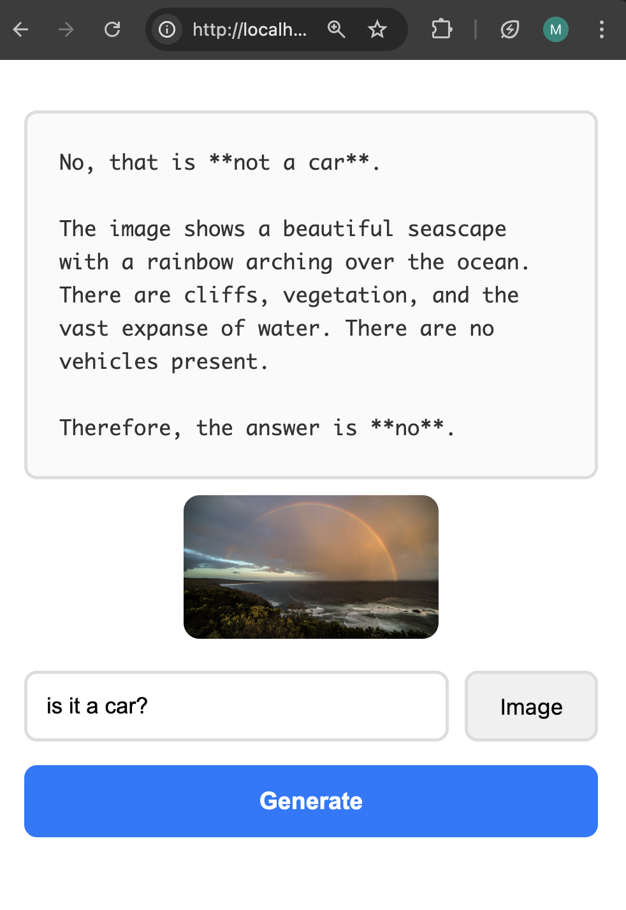

# Chrome Prompt API Demo

Local AI-powered text and image analysis using Gemini Nano directly in your browser. Works completely offline after initial setup.

## Features

- 🚀 Runs locally without internet connection
- 🖼️ Supports image analysis
- ⚡ Streaming responses for real-time output
- 🔒 Privacy-first - no data leaves your device
- 💰 Zero API costs

## Requirements

### Hardware
- **Storage**: 22GB free disk space (model is ~4GB)
- **GPU**: 4GB+ VRAM, OR
- **CPU**: 16GB+ RAM with 4+ cores

### Software
- **Chrome**: Version 138 or later
- **OS**: Windows 10/11, macOS 13+, Linux, or ChromeOS

## Setup Instructions

### 1. Enable Chrome Flags

1. Open Chrome and navigate to `chrome://flags`
2. Search and enable these two flags:
   - `chrome://flags#optimization-guide-on-device-model`
   - `chrome://flags#prompt-api-for-gemini-nano-multimodal-input`
3. Click **Relaunch** button at the bottom

### 2. Download the Model

The model downloads automatically on first use:

1. Open `index.html` in Chrome
2. Enter any prompt and click **Generate**
3. Wait for download to complete (~4GB, takes 10-20 minutes)

**Track download progress:**
- Open `chrome://on-device-internals` in a new tab
- Check "Foundational Model" section for download status

### 3. Verify Installation

Once downloaded, check the status at `chrome://on-device-internals`:

### 4. UI 

### 5. See original documentation: 
https://developer.chrome.com/docs/ai/prompt-api

